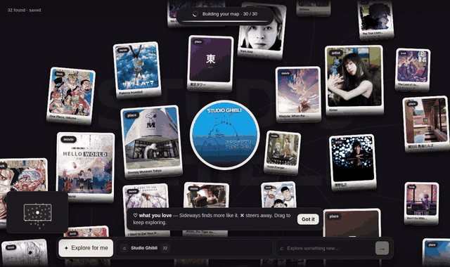

<div align="center">

# Throughline

**Turn one trusted reference into an explainable creative territory.**

A Qloo-powered research agent for **creative strategists**: turn one cultural reference into a defensible creative brief. Throughline connects evidence-backed references across media, preserves the path behind every choice, and turns the exploration into a shareable taste brief.

[](https://qloo.com)
[](https://typesafe.ai)
[](https://nextjs.org)
[](LICENSE)



</div>

## The problem

Creative research is fragmented across Google, Pinterest, Spotify, IMDb, TikTok, and travel sites. Researchers manually connect results, lose provenance, and struggle to explain why a set of references belongs together. Generic AI can make that process faster, but can also produce plausible cultural references without trustworthy affinity evidence.

Throughline gives the user an active, inspectable alternative: start with any real cultural entity, cross into books, films, music, places, games, food, or brands, and always retain one road back to the source. Qloo is essential to the product because it supplies the verified entities and cross-domain affinity graph; JEV decides which evidence-backed branches are worth growing next.

**Success condition:** within five minutes, a creative professional saves five useful references across at least three categories, understands why they connect, and exports a brief they could use in a moodboard, campaign, treatment, or pitch.

> **Live demo:** https://throughline.51-21-210-47.sslip.io

## Three-minute judge path

1. Start with **Spirited Away** (the first starter chip) and point out that every result is a real Qloo entity.
2. Hover a discovery to reveal its single causal road home; open it to read the exact route and Qloo evidence.
3. **Save to brief** one useful result and mark another **Not for this brief**.
4. Run **Explore for me**. JEV evaluates the whole map and the local Taste GraphRAG packet, then Qloo supplies the next verified entities.
5. Switch to **Gallery** to review discoveries by category, then return to **Map** without changing the saved layout.
6. Open **Brief** to show the themes, category coverage, exact paths, Qloo evidence, and Markdown/share output.

## How it works

```
  one seed          Qloo taste graph            your map
 ┌─────────┐       ┌────────────────┐       ┌──────────────┐
 │ Studio  │ ───▶  │ films · music  │ ───▶  │   5 cards,   │
 │ Ghibli  │       │ books · games  │       │  one road    │
 └─────────┘       │ places · brands│       │  back home   │
                   └────────────────┘       └──────┬───────┘
                                                   │
        ┌──────────────────────────────────────────┤
        ▼                      ▼                   ▼
   ♥ Save to brief        ✕ Not for me       ✦ Explore for me
   adds to the brief,     removes it,        agent picks branches,
   tunes future scoring   taste learns       JEV scores candidates,
   (no new cards)                            adds up to five
```

## What you get

| | |
|---|---|
| **Focused start** | One seed opens with at most five cross-domain cards. The map grows only after you choose a direction, rate a result, or ask the agent to explore. |
| **Save to brief / Not for this brief** | Curates the final artifact and re-ranks what comes next. Saving does not trigger a surprise API call. |
| **Taste brief** | Converts saved references into themes, category coverage, exact paths, Qloo evidence, sources, and portable Markdown. |
| **One road home** | Select a card and the path back to your seed lights up. The rest fades. |
| **Explore for me** | Scores the whole map against your saved likes, dislikes, and local Taste GraphRAG memory, then grows the strongest branches. |
| **More like this** | Per card, predictable choices such as “More movies like this” and “More books like this,” grounded in Qloo affinity. |
| **Learn links** | YouTube, TikTok, Reddit, Wikipedia, IMDb, Goodreads, Spotify. Best search picked per card. |
| **Ambiguous seeds** | "Bears" means team, show or animal. Switch meaning in place. Maps are cached. |
| **Share links** | A polished preview plus native sharing, social actions, and an exact portable link containing the current graph and saved references. |
| **Semantic zoom** | Far views become a compact visual index; near views reveal names, types, affinity, actions, and paths. |
| **Bounded working set** | Automatic growth stops before the canvas becomes unreadable; the full taste history remains in local memory. |

## Explore for me

Click **Explore for me** in the left rail to grow your existing map using your feedback. Each run:

1. Evaluates every current node except items marked **Not for me**. JEV scores nodes in batches using their descriptions, tags, connections, and your saved likes and dislikes.
2. Ranks the branches, with a bonus for brief-ready saved picks. Previously explored nodes can still produce new discoveries.
3. Uses JEV to choose a relevant category for each selected branch, deliberately favoring missing categories in creative-research mode, then asks Qloo for real entities connected to that source.
4. Keeps only candidates that pass the shared relevance gate (`lib/relevance.ts`): Qloo affinity of at least **0.80**, a JEV *specific shared subject* score of at least **0.60**, a *broad-genre-only* score of at most **0.65**, and a gap of at least **0.20** between the two. Candidates without a description or tags never qualify. The agent then orders the qualified candidates by relevance, taste fit and affinity. These are filtering heuristics, not calibrated ratings. Measure them with `npm run test:relevance`.
5. Adds the best qualified discoveries across branches, **five per run** in total,, excluding existing nodes and rejected items. If a category is empty, it tries another; if candidates are too weak, it moves to another branch rather than forcing them into the map.

Each run adds at most **five** cards and may add fewer when strong matches are scarce. When fewer than three strict matches exist, a clearly labelled **looser** tier may fill in; factual Wikidata links (written by, based on, same creator) are labelled as Wikidata, not Qloo. Newly added nodes become eligible for evaluation on the next run. The activity panel shows progress and results; the map keeps its current position and zoom while new cards arrive.

**Save** gives a node more weight in future exploration. **Not for me** excludes that entity and contributes its tags and category to the preference context; it does not ban the entire category. Feedback is stored locally in your browser.

JEV is the only model used for reasoning, scoring, and selection; Qloo supplies the verified discoveries. There is no second LLM and no pretend embedding service. **JEV is required for discovery.** Without it, affinity requests return *Relevance checking is temporarily unavailable* instead of unverified matches. Only direct creator credits work without it. Throughline never invents entities to fill a branch.

## Local Taste GraphRAG memory

Throughline learns across explorations without creating an account. A versioned IndexedDB database named `sideways-memory` stores compact, browser-local facts:

- entities seen and their Qloo tags;
- the exact parent → discovery edges that explain each route;
- sessions and weighted events such as open, love, reject, explore, and resume;
- recency-decayed positive and negative anchors.

Before a discovery request, the client retrieves a small evidence packet from this graph: positive anchors, negative anchors, preferred types and tags, the recent path, and IDs to avoid. Only this bounded packet is sent to the server. JEV reranks Qloo's real candidates against it. Full browsing history and raw API responses are never sent as model context.

This is intentionally **GraphRAG-style retrieval**, not a fake vector database: graph/event retrieval is local and explainable, and JEV is the sole semantic judge. `localStorage` remains only for map snapshots and lightweight preferences.

## Under the hood

| Part | Does |
|---|---|
| **Qloo** `/search` | Resolves the seed to a real entity. |
| **Qloo** `/v2/insights` | Affinity-ranked results per category, with tags, descriptions and external IDs. |
| **JEV** | Scores which branch the agent grows, which candidates it keeps, which link searches fit, which directions to offer. |
| **IndexedDB Taste GraphRAG** | Stores local entities, routes, sessions, and feedback; retrieves a compact evidence packet for JEV. |
| **Our ranking** | Qloo affinity + quality + your loves and rejects. Dedupes and stays on-path. |

## Run it

```bash
git clone https://github.com/JacobTheJacobs/sideways.git
cd sideways
npm install
cp .env.example .env.local   # add your keys
npm run dev                  # http://127.0.0.1:5173
```

| Variable | What |
|---|---|
| `QLOO_API_KEY` | Qloo hackathon key |
| `QLOO_BASE_URL` | Qloo API base URL |
| `JEV` | JEV key (typesafe.ai) |
| `NEXT_PUBLIC_APP_URL` | Public deployed origin used in share links, for example `https://throughline.example` |

`JEV` is required: affinity discovery is withheld (503) rather than shown unverified when it is missing.

## Troubleshooting

Dev server refuses to start (stale lock): `rm -f .vinext/dev/lock.json`, then `npm run dev`.

## Safety

- Keys stay server-side.
- Per-IP rate limits on every API route.
- Same-origin check and request size cap.

## License

[MIT](LICENSE)

## Test

```bash
npm run test:unit            # guard, JEV scoring, body limits
python3 tests/ui_mock.py     # mocked API, no keys needed
python3 tests/judge_flow.py  # live browser flow; dev server running, needs playwright
npm run test:study           # consent, recovery, privacy, mobile, and evidence gates
```

## Impact evidence study

The public evidence claim is intentionally separated from the product demo:

- `/study` is the hidden participant flow. It creates an anonymous browser-local ID, counterbalances the two tasks, locks timing and condition at task start, autosaves, and exports checksummed JSON and CSV records.
- `/study/review` is the local researcher workspace. Import participant JSON files there; malformed, duplicate, abandoned, and incomplete pairs are excluded. Reviewers see randomized anonymous outputs without condition labels.
- `/evidence` is the public protocol and results page. It reads the committed [`public/evidence.json`](public/evidence.json) aggregate and shows “Study in progress” until ten valid paired sessions and two complete blinded reviews exist.

Collection procedure:

1. Recruit 10–15 creative professionals and send each person the `/study` URL.
2. Collect both exported files, retaining JSON as the authoritative record and CSV for inspection.
3. Import the JSON records into `/study/review` and record every exclusion shown by the workspace.
4. Have two experienced creative reviewers complete scoring independently using different reviewer codes.
5. Export the public aggregate only when the workspace unlocks it. Inspect unfavorable outcomes and limitations; do not edit them away.
6. Replace both `data/evidence.json` and `public/evidence.json` with that exact aggregate, rerun all tests, and publish.

No study telemetry is produced during ordinary app use. Participant data never leaves the browser automatically.

## Submission readiness

See [docs/SUBMISSION.md](docs/SUBMISSION.md) for the final Devpost copy, judge checklist, honest user-study protocol, deployment gate, and known hackathon-scale limitations.
# Synthetic evaluation rehearsal

`/evidence/synthetic` runs a deterministic, personality-driven rehearsal with 12 simulated creative-professional personas and two simulated reviewers. It is intentionally stored and presented separately from the human study and is labeled **Synthetic—not human evidence**. A fixed seed reproduces a run; changing it explores variance. The downloadable artifact includes its seed, engine version, personas, disclosure, sessions, reviews, and aggregate.

Synthetic outcomes are useful for testing study instrumentation and analysis. They are not user research and must not be used as hackathon impact statistics. The public `/evidence` page continues to show only validated human results after its pre-registered gates are met.
